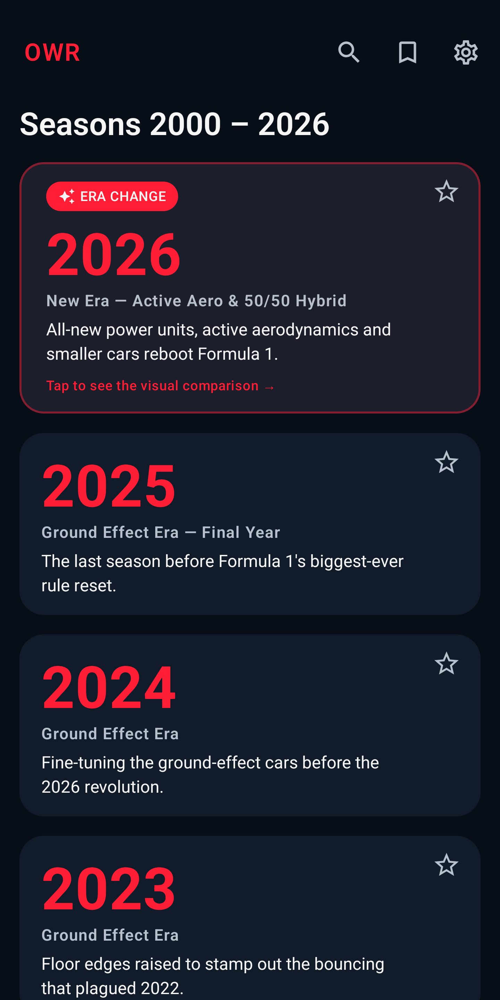
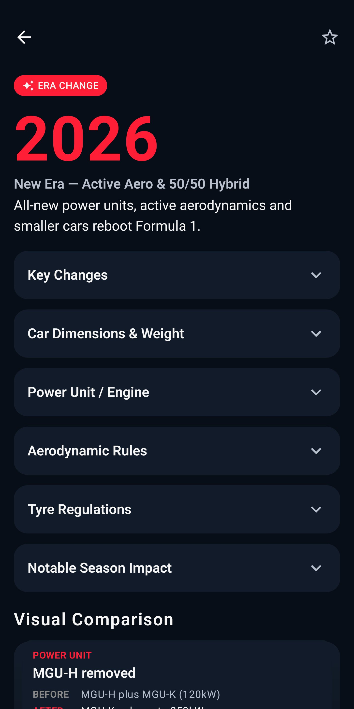
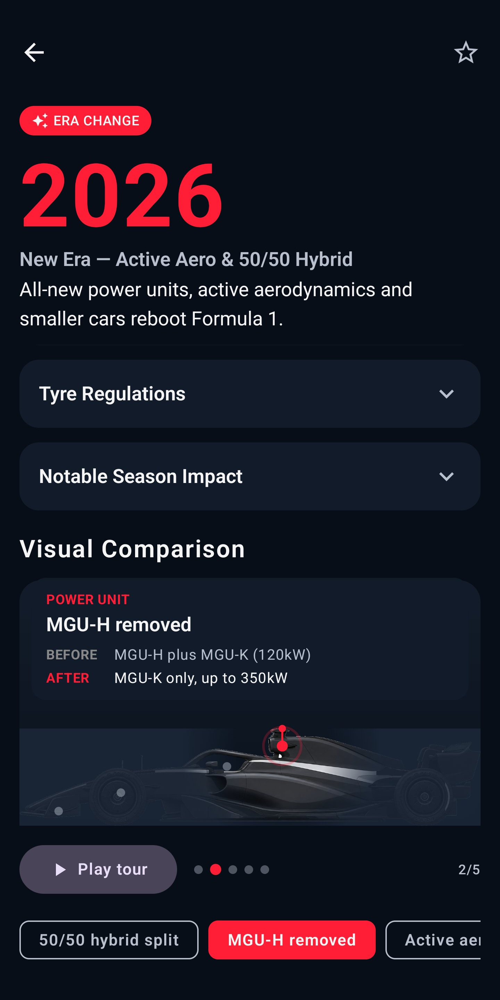
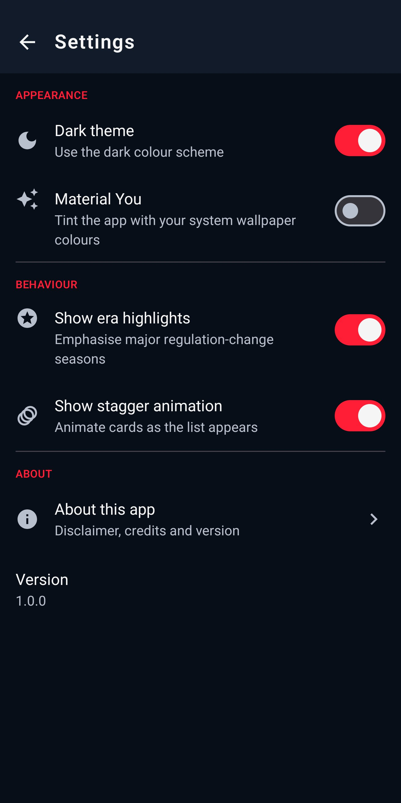

[English](README.md) | [ქართული](README.ka.md)

# Open Wheel Regulations (OWR)

**ღია თვლებიანი (open-wheel) ავტოსპორტის ტექნიკური რეგულაციების ისტორიის ოფლაინ Android-აპლიკაცია.**

OWR საშუალებას გაძლევთ, სეზონ-სეზონ დაათვალიეროთ 27 სეზონი (2000–2026): ნახოთ, რა წესები მოქმედებდა, რა შეიცვალა ყოველ წელს და რატომ იყო ეს მნიშვნელოვანი, და როგორ ვითარდებოდა ბოლიდები — მათ შორის ინტერაქტიული „მანამდე/შემდეგ“ შედარებები მთავარი რეგულაციური ეპოქებისთვის. ყველა მონაცემი აპლიკაციაშია ჩაშენებული, ამიტომ ის სრულად ოფლაინ მუშაობს — რეკლამის, ანგარიშისა და მონაცემთა შეგროვების გარეშე.

---

## ჩამოტვირთვა

📥 **[ჩამოტვირთეთ უახლესი APK Releases გვერდიდან](https://github.com/h0taa/OpenWheelRegulations_App/releases/latest)** — დააინსტალირეთ პირდაპირ თქვენს Android ტელეფონზე (Android 8.0+).
ინსტალაციისას Android-მა შეიძლება მოგთხოვოთ დაშვება ბრაუზერიდან/ფაილების მენეჯერიდან ინსტალაციაზე — ეს ნორმალურია Google Play-ს გარეთ გავრცელებული აპლიკაციებისთვის.

---

## ეკრანის სურათები

| სეზონების სია | სეზონის დეტალები | ვიზუალური შედარება | პარამეტრები |
|:---:|:---:|:---:|:---:|
|  |  |  |  |


---

## ფუნქციები

- **27 სეზონი (2000–2026)** — თითოეული მარტივ ენაზე აღწერილი ძირითადი ცვლილებებითა და მათი მნიშვნელობით.
- **მთავარი ეპოქების გამოყოფა** — მონიშნულია სეზონები, რომლებმაც სპორტი გარდაქმნეს.
- **გაშლადი წესების კატეგორიები** ყოველი სეზონისთვის — ძრავა/ენერგობლოკი, აეროდინამიკა, საბურავები, ბოლიდის ზომები და წონა და სხვა.
- **ინტერაქტიული ვიზუალური შედარება** — ნაბიჯ-ნაბიჯ „მანამდე/შემდეგ“ მიმოხილვა, თუ როგორ შეიცვალა ბოლიდი მსხვილი რეგულაციური ცვლილებებისას.
- **სანიშნეები და ძიება** — შეინახეთ თქვენთვის საინტერესო სეზონები და სწრაფად მონახეთ ისინი.
- **ღია და მუქი თემები**, ასევე Material You დინამიკური ფერები.
- **100% ოფლაინ** — ინტერნეტთან წვდომის, რეკლამის, რეგისტრაციის, თვალთვალისა და ნებართვების გარეშე.

---

## ტექნოლოგიები

- **ენა:** Kotlin
- **ინტერფეისი:** Jetpack Compose (Material 3), shared-element გადასვლებით
- **არქიტექტურა:** MVVM
- **ლოკალური მონაცემები:** Room (მონაცემთა ბაზა) და DataStore (პარამეტრები)
- **Dependency injection:** Hilt
- **ნავიგაცია:** Navigation-Compose

---

## მოთხოვნები

- Android Studio (უახლესი სტაბილური ვერსია)
- Android მოწყობილობა ან ემულატორი **Android 8.0 (API 26)** ან უფრო ახალი ვერსიით

---

## აწყობა და გაშვება

```bash
git clone https://github.com/h0taa/OpenWheelRegulations_App.git
```

1. გახსენით კლონირებული საქაღალდე **Android Studio**-ში.
2. დაელოდეთ Gradle-ის სინქრონიზაციის დასრულებას.
3. აირჩიეთ მოწყობილობა ან ემულატორი (API 26+) და დააჭირეთ **Run**-ს.

API გასაღებები, ანგარიში ან ინტერნეტი საჭირო არ არის — აპლიკაცია სრულად ავტონომიურია.

---

## პროექტის სტრუქტურა

```
app/src/main/java/com/openwheel/regulations/
├── data/            # Room ბაზა, მონაცემთა მოდელები, repository
│   ├── db/
│   ├── model/
│   └── repository/
├── di/              # Hilt dependency-injection მოდულები
├── ui/              # Jetpack Compose ეკრანები და ინტერფეისი
│   ├── home/        # სეზონების სია
│   ├── detail/      # სეზონის დეტალები + ვიზუალური შედარება
│   ├── bookmarks/
│   ├── settings/
│   ├── about/
│   ├── splash/
│   ├── components/  # მრავალჯერ გამოყენებადი composable-ები
│   ├── navigation/
│   └── theme/       # ფერები, ტიპოგრაფია, თემები
└── util/
```

---

## მონაცემები

რეგულაციების მთელი შინაარსი ოფლაინ ჩაშენებულია ფაილში `app/src/main/assets/regulations_data.json` და პირველი გაშვებისას ჩაიტვირთება ლოკალურ Room ბაზაში. თუ ბაზა ცარიელია, ის თავად აღიდგენს მონაცემებს ჩაშენებული ფაილიდან, ასე რომ აპლიკაციას ყოველთვის აქვს მონაცემები ინტერნეტის გარეშე.

---

## კონფიდენციალურობა

OWR არ აგროვებს პერსონალურ მონაცემებს, არ ითხოვს ნებართვებს და არ ამყარებს ქსელურ კავშირს.
კონფიდენციალურობის პოლიტიკა: https://h0taa.github.io/owr-privacy/

---

## განცხადება

Open Wheel Regulations არის დამოუკიდებელი საინფორმაციო აპლიკაცია. ის არ არის დაკავშირებული, მხარდაჭერილი ან ასოცირებული რომელიმე ავტოსპორტის სერიასთან, გუნდთან, სპონსორთან ან მმართველ ორგანოსთან და არ იყენებს არანაირ ოფიციალურ სახელს ან ლოგოს.
